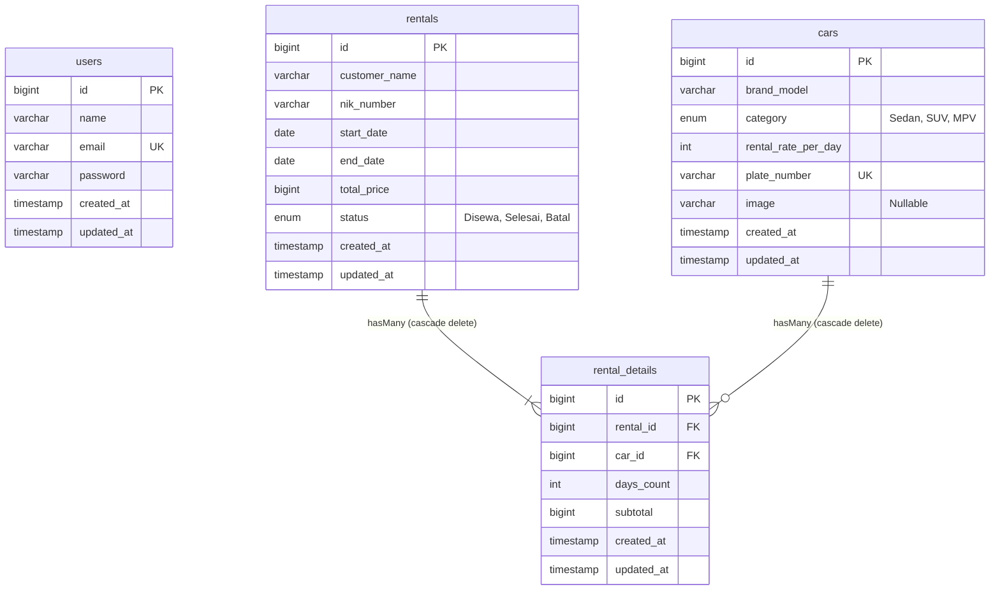

# 🏎️ APEX EXOTICS - Luxury & Supercar Rental System

Aplikasi web modern berbasis **Laravel 12**, **MySQL**, dan **Bootstrap 5** bertema *"Luxury Dark Automotive"* untuk penyewaan supercar, sport sedan, super SUV, dan VIP luxury vehicles. Dilengkapi katalog showroom interaktif, real-time live price calculator, pencegahan bentrok jadwal (anti double-booking), faktur sewa VIP, serta admin cockpit yang komprehensif.

---

## 🌟 Fitur Utama

### 1. Showroom & Modul Pelanggan (Publik)
- **Tema Luxury Dark Glassmorphism**: Desain eksklusif beraksen *Carbon Dark*, *Racing Red* (`#e11d48`), dan *Metallic Gold* (`#d4af37`).
- **Katalog & Filter Interaktif**: Filter cepat berdasarkan kategori armada (*Sport Sedan & Coupe*, *Super SUV Performance*, dan *VIP Presidential Lounge*) serta rentang tanggal sewa.
- **Pengecekan Ketersediaan Real-Time**: Hanya menampilkan armada yang tersedia dan tidak sedang dalam status `'Disewa'` pada tanggal yang dipilih.
- **Form Pemesanan & Live Price Calculator**: Kalkulator live menggunakan JavaScript yang otomatis menghitung durasi hari sewa (`days_count`) dan estimasi total biaya sewa (`subtotal`) sebelum formulir disubmit.
- **Validasi Anti Double-Booking**: Sistem memvalidasi ketersediaan mobil secara ketat di sisi server untuk mencegah pesanan ganda pada tanggal yang bertabrakan.
- **Struk / Faktur Digital VIP**: Halaman bukti reservasi dengan nomor faktur unik (contoh: `RNT-00001`), detail identitas, rincian biaya, serta tombol cetak invoice langsung (`window.print()`).

### 2. Admin Cockpit (Wajib Login)
- **Autentikasi Aman**: Login administrator dengan proteksi sesi, enkripsi kata sandi (bcrypt), dan fitur logout.
- **Dashboard Ringkasan KPI**: Statistik total unit armada, unit yang sedang disewa, total riwayat transaksi, estimasi perputaran omzet, serta tabel transaksi terbaru.
- **Manajemen Armada Supercar (CRUD + Upload Foto)**: Tambah, edit, lihat, dan hapus data supercar lengkap dengan upload gambar ke storage lokal, validasi berkas, dan *live image preview*.
- **Manajemen Transaksi & Status Sewa**: Kelola status transaksi (`Disewa`, `Selesai`, `Batal`). Mengubah status menjadi `Selesai` atau `Batal` secara otomatis membebaskan jadwal armada mobil agar kembali tersedia untuk disewa pada tanggal lain.

---

## 🛠️ Tech Stack & Dependensi

- **Backend Framework**: Laravel 12 (PHP 8.2+)
- **Database**: MySQL (`db_rental_mobil`)
- **Frontend / Styling**: Bootstrap 5.3, Bootstrap Icons 1.11, Google Fonts (*Plus Jakarta Sans* & *Cinzel*)
- **Automated Testing**: PHPUnit (Unit & Feature Tests)

---

## 📊 Skema Database (`db_rental_mobil`)



---

## 🚀 Panduan Instalasi & Menjalankan Proyek

### 1. Kloning Repositori
```bash
git clone https://github.com/charlimuzaki29-maker/rental_mobil.git
cd rental_mobil
```

### 2. Install Dependensi PHP via Composer
```bash
composer install
```

### 3. Konfigurasi Environment (`.env`)
Salin berkas `.env.example` menjadi `.env`:
```bash
cp .env.example .env
php artisan key:generate
```

Sesuaikan konfigurasi database pada `.env`:
```env
DB_CONNECTION=mysql
DB_HOST=127.0.0.1
DB_PORT=3306
DB_DATABASE=db_rental_mobil
DB_USERNAME=root
DB_PASSWORD=
```

### 4. Buat Basis Data & Jalankan Migrasi + Seeder
Pastikan MySQL service telah berjalan (misalnya melalui XAMPP), lalu buat database:
```sql
CREATE DATABASE IF NOT EXISTS db_rental_mobil;
```

Jalankan migrasi tabel beserta seed data awal armada supercar & akun admin:
```bash
php artisan migrate:fresh --seed
```

### 5. Hubungkan Direktori Storage
```bash
php artisan storage:link
```

### 6. Jalankan Server Pengembangan
```bash
php artisan serve
```
Akses aplikasi melalui browser:
- **Katalog Publik**: [http://127.0.0.1:8000](http://127.0.0.1:8000)
- **Admin Cockpit**: [http://127.0.0.1:8000/admin/login](http://127.0.0.1:8000/admin/login)

---

## 🔑 Kredensial Administrator Bawaan

| Keterangan | Nilai |
|---|---|
| **URL Login** | `/admin/login` atau `/login` |
| **Email** | `admin@rentalmobil.com` |
| **Password** | `admin123` |

---

## 🏎️ Koleksi Armada Supercar Awal (Seeder)

1. **BMW M3 Competition G80** | Sedan | Rp 7.500.000 / hari | Plat: `B 3 M`
2. **Mercedes-AMG GT Coupe** | Sedan | Rp 10.500.000 / hari | Plat: `B 63 AMG`
3. **Porsche Panamera Turbo S** | Sedan | Rp 11.500.000 / hari | Plat: `B 911 POR`
4. **Lamborghini Urus Performante** | SUV | Rp 18.000.000 / hari | Plat: `B 1 URUS`
5. **Porsche Cayenne Turbo GT** | SUV | Rp 12.500.000 / hari | Plat: `B 999 GT`
6. **Aston Martin DBX707** | SUV | Rp 15.000.000 / hari | Plat: `B 707 DBX`
7. **Lexus LM 350h VIP Lounge** | MPV | Rp 8.500.000 / hari | Plat: `B 1 VIP`
8. **Toyota Alphard Executive Lounge** | MPV | Rp 5.000.000 / hari | Plat: `B 888 LUX`

---

## 🧪 Pengujian Otomatis (Automated Testing)

Proyek ini telah dilengkapi serangkaian automated feature & unit tests yang mencakup seluruh alur kerja:
```bash
php artisan test
```

Semua 9 test suite terverifikasi **Pass (100%)**:
- Public catalog display & category filter
- Customer booking & auto price calculation
- Anti double-booking validation
- Admin authentication & route protection
- Supercar CRUD with image upload
- Rental status updates & lifecycle
